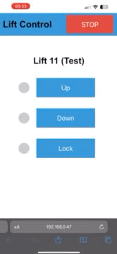
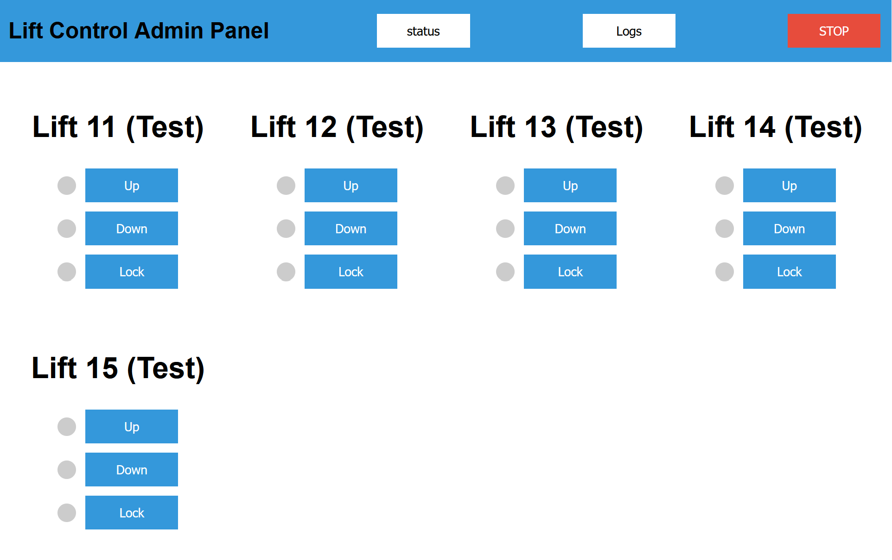
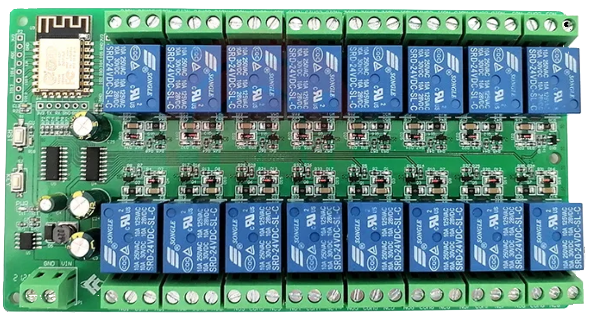

# smart-lift

Websteuerung für Doppelparklifte: Vue-Oberfläche, FastAPI-Backend und
ESP8266-/ESP12F-Relaiscontroller. Jeder Controller stellt fünf Lifte mit den
Funktionen Hoch, Runter und Entriegeln bereit. Die Relais simulieren die
Taster der vorhandenen Liftsteuerung; parallel verdrahtete Handtaster bleiben
unabhängig von dieser Software.

| Mobil | Desktop |
| --- | --- |
|  |  |

## Betriebsstand

Firmware `0.06.03`, Protokoll **2**. Backend, Frontend und Firmware müssen
gemeinsam aktualisiert werden; Controller mit dem alten Protokoll werden
abgewiesen. Die Software enthält:

- erneuerbare Fahrfreigaben: Browser alle 200 ms, Backend-Ablauf nach 500 ms,
  ESP-Ablauf nach 750 ms;
- genau einen Besitzer und eine Richtung je Lift;
- verriegelten STOP mit ausdrücklichem Reset und Bestätigung aller verbundenen
  Controller; Neustarts beginnen gesperrt;
- Abschaltung bei Abbruch, Schutz vor alten Befehlen, keine automatische
  Wiederaufnahme nach Wiederverbindung;
- validierte Nachrichten, WLAN-Wiederholung, TLS-Prüfung und optionales
  Controller-Token für WebSocket und OTA;
- Tests für Backend, Browserlogik und die tatsächliche C++-Relaiszustandsmaschine.

Vorgesehen ist ein **vertrauenswürdiges LAN oder VPN**. Bediener werden nicht
durch einen Anwendungslogin authentifiziert. Die Netzgrenze ist deshalb Teil
der Zugriffssicherung. Kein Portforwarding ins Internet. Die mitgelieferte
Compose-Konfiguration stellt HTTP bereit; TLS erfordert einen bewusst
konfigurierten vorgeschalteten TLS-Endpunkt.

Builds und Softwaretests ersetzen keine Prüfung am Relaisboard. Die
Abschaltzeiten arbeiten kooperativ und sind keine garantierten Echtzeitfristen.
Der Web-STOP ersetzt keine unabhängige Not-Halt-Schaltung. Die vollständigen
Betriebsgrenzen und die noch erforderliche Inbetriebnahme stehen in
[docs/operations.md](docs/operations.md).

## Installation

Voraussetzungen: Docker mit Compose v2, für Firmware zusätzlich
[Arduino CLI](https://arduino.github.io/arduino-cli/installation/) und ein
geeigneter LittleFS-Uploader.

```bash
cp .env.example .env
mkdir -p data binaries
```

In `.env` die `SMARTLIFT_BIND_ADDRESS` auf die LAN-Adresse des Servers setzen.
Ohne Änderung bleibt die Anwendung ausschließlich über Loopback erreichbar.
Unter Linux `SMARTLIFT_UID` und `SMARTLIFT_GID` auf die Eigentümer von `data/`
setzen (`id -u`, `id -g`).

Optional ein zufälliges `SMARTLIFT_CONTROLLER_TOKEN` eintragen und denselben
Wert in jeder ESP-Konfiguration als `controller_token` verwenden. Das Token
schützt Controller-Verbindungen und OTA, nicht die Bedienoberfläche. Ein Token
über HTTP ist nur im vertrauenswürdigen Netz geschützt.

Firmware-Abhängigkeiten, mit diesen Versionen geprüft:

```bash
arduino-cli core update-index --additional-urls https://arduino.esp8266.com/stable/package_esp8266com_index.json
arduino-cli core install esp8266:esp8266@3.1.2 --additional-urls https://arduino.esp8266.com/stable/package_esp8266com_index.json
arduino-cli lib install ArduinoJson@7.4.3 WebSockets@2.6.1
bash init.sh
```

Die Firmware-Build-Matrix prüft ArduinoJson 6.21.5 und 7.4.3 jeweils mit
WebSockets 2.6.1 und 2.7.2. Die Firmware verwendet keine internen
Disconnect-Überladungen der WebSocket-Bibliothek.

`init.sh` erzeugt `binaries/0.06.03.bin` und übernimmt vorhandene
`lift_info.json` einmalig nach `data/lift_info.json`. Der Build setzt
`WEBSOCKETS_TCP_TIMEOUT=100` für alle C++-Übersetzungseinheiten; diesen Parameter
auch beim manuellen IDE-Build setzen.

[esp12f/data/default.json](esp12f/data/default.json) nach
`esp12f/data/config.json` kopieren, SSID, Passwort, Server, Port und eindeutige
`con_id` (beginnend mit `con`) eintragen. `lift_begin` bestimmt die erste der
fünf fortlaufenden Lift-IDs. Beim TLS-Betrieb zusätzlich die passende CA-Datei
hochladen: `isrg_root_x1.pem` für `public_ca`, `server.crt` für `self_signed`.
Ungültige Konfigurationen lassen die Ausgänge gesperrt und werden seriell
gemeldet. `tls_mode: insecure` wird nicht unterstützt.

Sketch mit Board `esp8266:esp8266:nodemcuv2` und anschließend den Datenordner
mit LittleFS hochladen. Hardware nicht während einer Bewegung aktualisieren.

```bash
docker compose config --quiet
docker compose up -d --build
docker compose ps
```

Oberfläche: `http://<LAN-Adresse>:8080/`. Nach dem Verbindungsaufbau alle
Bedienelemente loslassen und **STOP zurücksetzen / freigeben** wählen. Eine
Bewegung benötigt danach einen neuen Tastendruck.

## Entwicklung und Tests

Python 3.12:

```bash
python -m venv .venv
# Linux/macOS: source .venv/bin/activate
# PowerShell: .venv\Scripts\Activate.ps1
pip install -r backend/requirements.lock -r backend/requirements-dev.txt
cd backend
python -m unittest discover -s tests -v
uvicorn app.main:app --host 127.0.0.1 --port 8000 --workers 1 --ws-max-size 4096 --ws-ping-interval 1 --ws-ping-timeout 2
```

Das Backend läuft mit **einem Worker**. Verbindungen, Eigentümer und STOP-Zustand
liegen im Prozessspeicher und erlauben aktuell weder mehrere Worker noch
mehrere Backend-Replikate. Namen werden unter `SMARTLIFT_DATA_DIR` gespeichert
(Standard: `app/data`).

Frontend, Node 22.23.3:

```bash
cd frontend
npm ci
npm test
npm run build
npm run dev
```

Vite leitet `/api` standardmäßig an `http://127.0.0.1:8000` weiter.
`SMART_LIFT_API_TARGET` ändert ausschließlich dieses Entwicklungsziel.
Der Controller-Simulator liegt unter `/simulator#0-4`; er implementiert dasselbe
Protokoll einschließlich STOP und Zeitablauf. Mit konfiguriertem
Controller-Token ist er im Browser nicht als Controller zugelassen.

Native Firmwaretests:

```bash
g++ -std=c++11 -Wall -Wextra -Werror esp12f/tests/relay_leases_test.cpp -o relay-tests
./relay-tests
```

GitHub Actions führt Backendtests, Frontendtests/-Build/-Audit sowie ESP-Build
und native Relaisprüfungen aus. Details zur Kommunikation:
[docs/protocol.md](docs/protocol.md).

Eine englische Entwicklerdokumentation zu Modulen, Zuständen, Sperren und
Erweiterungen steht in [docs/architecture.md](docs/architecture.md).

## Hardware

Die bestehende Pinbelegung und Relaiszuordnung sind auf das abgebildete Board
ausgelegt. GPIO4 meldet Versorgungsspannung; GPIO2 ist ein Test-/Fehlertaster.
Beide sind keine unabhängigen Sicherheitsverriegelungen.

| Innen | Front | Relaisboard |
| --- | --- | --- |
|  |  |  |
