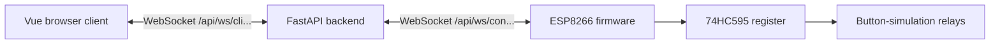

# Architecture and maintenance

This document explains the code's responsibilities and invariants. Operator
instructions remain in [operations.md](operations.md); wire examples are in
[protocol.md](protocol.md). Source comments and developer documentation use
English. User-facing messages may remain German.

## Components

Traefik routes `/api` to FastAPI and other paths to Nginx. The backend has **one
worker**: its connections, movements, STOP latch and watchdog live in process
memory. Adding workers or replicas without shared coordination would split
ownership and STOP state.

| Module | Responsibility |
| --- | --- |
| `backend/app/core/protocol.py` | Shared backend protocol version, identifier rules and wire limits. |
| `backend/app/core/security.py` | Optional controller-token verification for both OTA and WebSockets. |
| `backend/app/models/messages.py` | Strict message types: invalid actuator fields never default to a direction. |
| `backend/app/utils/message_parser.py` | Size limit and schema selection before role-specific dispatch. |
| `backend/app/websocket/` | Peer admission, controller registration, role permissions and complete session teardown. |
| `backend/app/managers/connection_manager.py` | Socket identities, bounded network I/O and serialized writes per peer. |
| `backend/app/managers/lift_manager.py` | Movement ownership, deadlines, STOP/reset coordination and persistent names. |
| `frontend/src/services/socketTransport.js` | Reconnection and transport failure; deliberately no movement queue. |
| `frontend/src/services/pressController.js` | Immutable press IDs, periodic renewal, exact release and stale-ACK handling. |
| `frontend/src/services/websocket.js` | Reactive server snapshots and operator-facing connection/control state. |
| `frontend/src/services/controllerSimulator.js` | Development controller following the same lease/reset contract as firmware. |
| `esp12f/RelayLeases.h` | Portable actuator state machine, independent of Arduino and network libraries. |
| `esp12f/ProtocolText.h` | Length-aware text validation shared by firmware parsing and native tests. |
| `esp12f/esp12f.ino` | GPIO, JSON, Wi-Fi, TLS, OTA and protocol integration around that state machine. |

## Movement ownership and deadlines

A movement is identified by `(con_id, lift_id)`. Its owner is the operator's
**socket identity**, not a client-supplied JSON value. Equal numeric lift IDs on
different controllers remain distinct control targets, although persistent
display names currently use the numeric lift ID alone.

Each press captures a unique `command_id`, a direction and the current
`control_epoch`. A renewal must match an active press exactly. It cannot start
an expired press, take over another operator or change direction. A delayed
release can only release its own press. All three functions of one lift are
mutually exclusive.

| Timing | Owner | Meaning |
| --- | --- | --- |
| 200 ms | Browser | Renewal interval while a button remains held. |
| 500 ms | Backend | Hold deadline, checked on renewal and by the watchdog. |
| 750 ms | ESP | Independent relay lease deadline, including `millis()` wraparound. |
| 3 s | Backend | Deadline for all controller reset acknowledgements. |

The backend uses monotonic time. The ESP uses unsigned elapsed-time arithmetic;
NTP is only needed for certificate validation. These are cooperative software
deadlines, not guaranteed physical stopping times. `lift_moved` reports a relay
command/state transition, not mechanical feedback from a lift.

## Locks, I/O and session lifetime

`LiftManager._lock` serializes domain transitions. Helpers ending in `_locked`
expect that lock to be held. State is invalidated before awaited STOP/release
traffic so a second request cannot revive a half-completed transition.

The connection registry lock never covers network I/O. IDs are reserved before
the bounded accept handshake. Each socket has a separate write lock, and the
send timeout includes waiting for that write lock. Failed sockets immediately
become unusable so subsequent broadcasts do not retry the same blocked peer.

Session teardown has two phases:

1. Mark the exact socket unusable while retaining its peer-ID reservation.
2. Clear domain state, then release that reservation.

The endpoint shields this complete sequence from caller cancellation. A small
task set holds strong references until cleanup completes. A new socket with
the same ID cannot be registered while old movement/controller state remains.
Rejected duplicate sockets never own the old session's cleanup.

## STOP, reset and watchdog failure

Boot starts STOP-latched. STOP invalidates holds, changes the control epoch and
cancels any pending reset. An operator reset only requests controller resets;
it does not clear the backend latch. Every current controller must acknowledge
the same fresh `reset_id` before the backend opens a new epoch.

On the ESP and simulator, retrying the last successful reset while already
unlatched is acknowledgement-only: it must not erase a newer movement. That
same ID cannot reopen a subsequent STOP latch. Firmware keeps only its last
accepted reset ID across reconnections, not a complete history or durable
storage across power cycles. The backend additionally correlates every reset
acknowledgement with its current reset barrier.

If the backend watchdog raises an unexpected exception, `watchdog_failed`
permanently blocks new holds and resets in that process. Health reports 503.
The operator cannot reset away a missing watchdog; investigate the log and
restart the backend. Normal STOP still has its ordinary acknowledged reset
flow. Compose health status alone does not restart an unhealthy process.

## Persistence and firmware updates

Names are written to a temporary file in the same directory, flushed, and
atomically replaced. Only a successful write updates live metadata or returns
success. The API returns the normalized name actually stored. Status endpoints
read detached snapshots instead of exposing the manager's mutable dictionaries.

OTA considers both `<version>.bin` and `<con_id>-<version>.bin`. It selects the
highest applicable version and prefers a controller-specific image only when
versions tie. Other controller IDs, invalid names and symlinks are ignored.
Transport trust and optional controller authentication are separate concerns;
signed firmware is not configured by this project.

## Browser lifecycle and rendering

Visibility loss, focus loss, navigation, STOP and transport failure end held
presses. Failed transport is detached **before** status listeners run because
those listeners synchronously release buttons. A renewal loop checks that each
press still exists after callbacks may have cancelled other presses.

The main view sorts globally by numeric lift ID and keys each card by both
controller and lift ID. Known offline cards remain visible for the current
browser session. If a newly connected controller changes the layout, active
presses and the wheel-navigation target are cancelled before reordering.
The normal operating view has no instructional status banner; connection and
STOP messages still appear when relevant.

## Verification and extension points

Run backend unit/integration tests, frontend tests/build and the isolated
frontend-to-backend protocol smoke test as described in the root and frontend
READMEs. The protocol smoke test owns temporary data and free test ports; never
point a simulator or movement test at a real lift installation.

The CI firmware matrix covers ArduinoJson 6.21.5 and 7.4.3 with WebSockets 2.6.1
and 2.7.2. JSON-version compatibility stays behind a small document alias;
WebSockets integration uses public APIs only. Native C++ tests execute the same
lease state machine included by the sketch.

When extending the protocol, preserve press identity, expiry, explicit reset
and no-replay behavior on every peer. New control fields require strict schema
validation and coordinated firmware/simulator behavior. Avoid silently changing
GPIO semantics: GPIO2 remains a test/error button and GPIO4 a power indication,
not independent interlocks. Hardware acceptance and a trusted LAN/VPN boundary
remain necessary deployment conditions.
